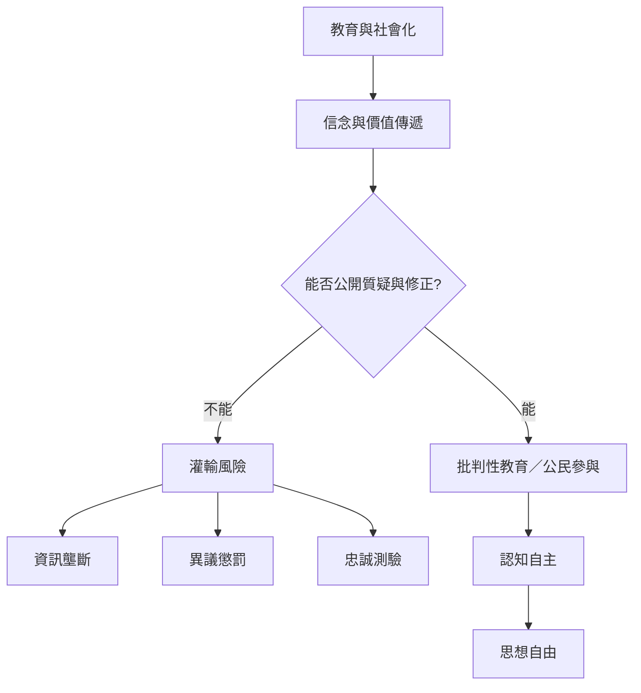

這張地圖整理如何判斷教育何時轉化為灌輸，核心不在於課程有沒有價值立場，而在於學習者能否理解理由、比較觀點、公開異議並修正信念。概念入口包括[[灌輸]]、[[教育]]、[[政治社會化]]、[[認知自主]]、[[思想自由]]與[[批判性思考]]。

## 思與行
* 用「內容、方法、意圖、結果、權力與退出成本」六個面向檢查教育情境。

## 參考
* [[教育哲學指出灌輸判準涉及內容方法意圖與學習結果]]；[[政治社會化與灌輸必須依可爭辯性區分]]；[[灌輸的關鍵不是教了什麼而是能否公開質疑]]；[[教育必然傳遞價值但仍可培養知識自主]]。
