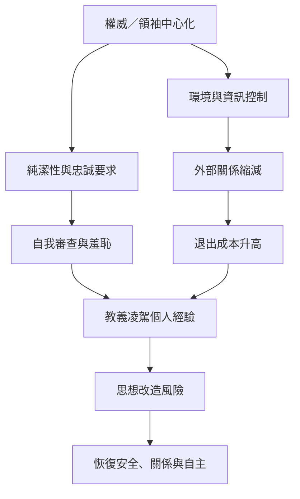

高控制團體研究關注資訊、關係、語言、日常生活與退出選擇如何被共同管理。不要只依信仰內容或團體名稱判斷，而要檢視具體的強制與剝削行為。連結[[思想改造]]、[[洗腦]]、[[高控制團體]]、[[思想自由]]與[[反灌輸措施不能以另一種強制控制取代原本控制]]。

## 思與行
* 對組織風險評估聚焦可觀察行為，保護成員自由與退出權，不把異端信念本身當作犯罪證據。

## 參考
* [[Robert Jay Lifton 以八項特徵分析思想改造與意識形態極權]]；[[灌輸透過日常儀式與歸屬感而不只透過命令運作]]；[[反灌輸措施不能以另一種強制控制取代原本控制]]。
