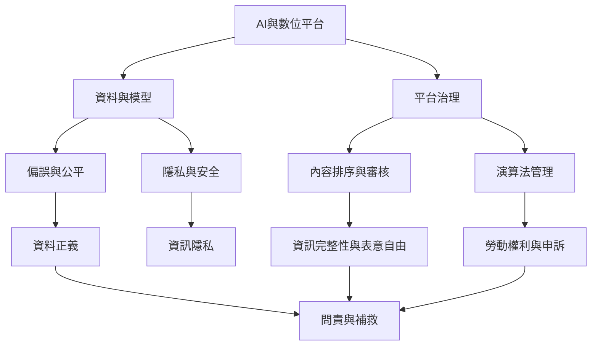

AI 與平台的倫理問題不只發生在模型本身，也來自資料來源、商業誘因、內容排序、部署場景、勞動管理與救濟制度。有效治理必須把人權、公平、透明、人工監督、申訴與環境責任連成一條責任鏈。

概念連結：[[人工智慧倫理]]、[[平台治理]]、[[演算法問責]]、[[演算法管理]]、[[數位勞動平台]]、[[資訊完整性]]、[[資料正義]]、[[資訊隱私]]。

延伸閱讀：[[資訊倫理必須同時分析個人制度與社會結構]]、[[資訊生命週期的每一階段都會產生不同倫理責任]]。
