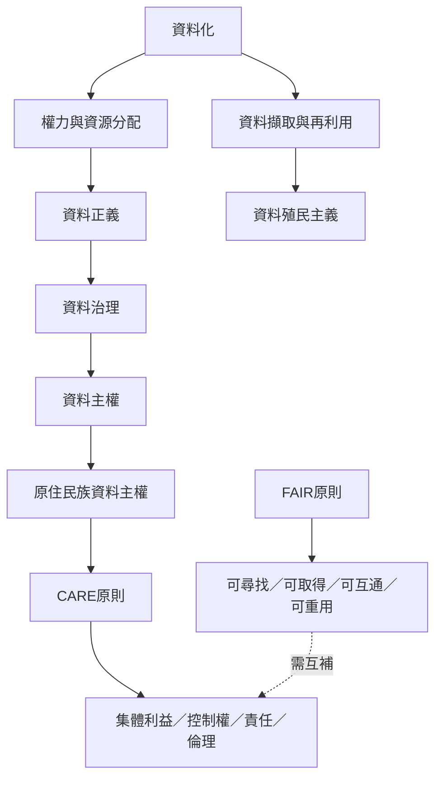

資料正義關注資料化如何重組權力，而資料主權與 CARE 原則進一步追問資料涉及的個人或集體能否參與規則制定、控制用途並分享利益。這張地圖將社會正義、文化脈絡與資料治理放在同一條關係鏈。

概念連結：[[資料正義]]、[[資料主權]]、[[原住民族資料主權]]、[[資料治理]]、[[資料殖民主義]]、[[CARE原則]]、[[FAIR原則]]。

延伸閱讀：[[資訊倫理必須同時分析個人制度與社會結構]]、[[資訊生命週期的每一階段都會產生不同倫理責任]]。
