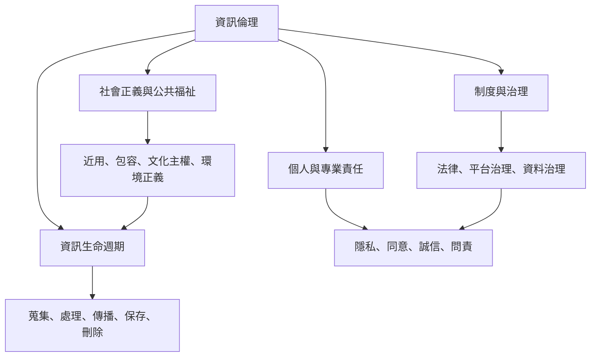

資訊倫理可以理解為一個跨層次的公共倫理領域：底層是資訊生命週期與技術基礎設施，中層是個人、組織與專業責任，上層是法律、文化、政治經濟與社會正義。全景閱讀應避免把問題縮小為個人網路禮儀或單一 AI 原則。

概念連結：[[資訊倫理]]、[[電腦倫理]]、[[資訊哲學]]、[[資訊圈]]、[[資訊生命週期]]、[[資料治理]]、[[資料正義]]、[[資訊近用]]。

延伸閱讀：[[資訊倫理必須同時分析個人制度與社會結構]]、[[資訊生命週期的每一階段都會產生不同倫理責任]]。
