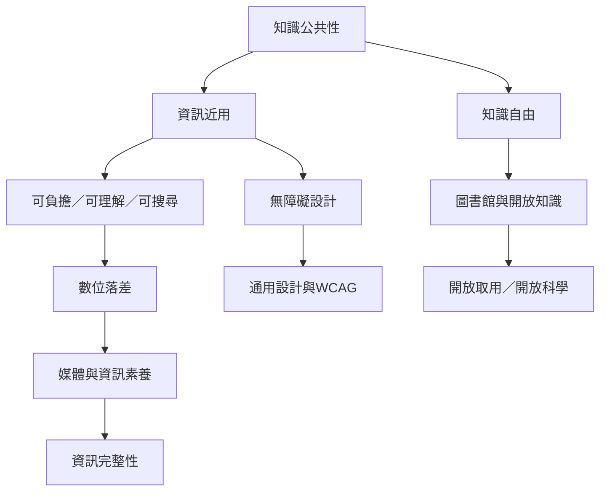

知識公共性不止於把檔案放上網路。人們需要有能力找到、理解、使用、檢驗與參與知識，也需要內容能被不同能力者近用。媒體與資訊素養、開放科學、圖書館倫理與數位包容共同構成知識公共性的條件。

概念連結：[[資訊近用]]、[[知識自由]]、[[媒體與資訊素養]]、[[數位落差]]、[[無障礙設計]]、[[通用設計]]、[[開放科學]]、[[開放取用]]。

延伸閱讀：[[資訊倫理必須同時分析個人制度與社會結構]]、[[資訊生命週期的每一階段都會產生不同倫理責任]]。
