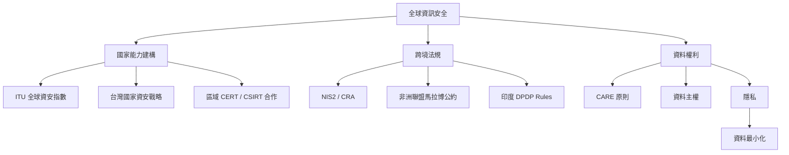

全球資訊安全需要比較不同地區的制度、能力、威脅與權利脈絡。國家層級框架、區域協定、產業規範與原住民族資料治理原則彼此互補，但不能互相取代。

## 關係圖

跨國比較需要同時讀法律文本與實施能力，並注意各地法律狀態、資源和文化脈絡。全球指數可以提供比較架構，卻不能取代地方社群的實際經驗與權利評估。

## 思與行
* 每個區域案例都標示法律狀態、制度能力、資料來源、觀察期間和可比較限制。
* 在政策建議中同時討論安全、隱私、資料主權、能力培力與跨境合作。

## 參考
* [[ITU 全球資安指數用五大支柱衡量國家承諾而非單純攻擊數量]]、[[非洲聯盟馬拉博公約把網路安全與個人資料保護放入區域治理框架]]、[[CARE 原則提醒資料治理必須尊重原住民族的集體利益與控制權]]。
