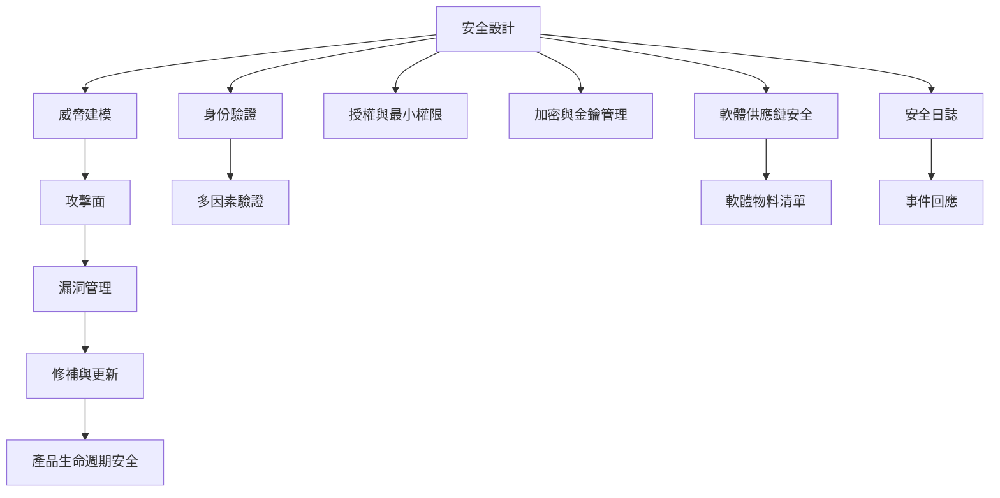

技術防禦要從架構與生命週期出發：先定義資產與信任邊界，再控制身份和權限、減少不必要的攻擊面、管理軟體依賴、保護資料，並以日誌和演練驗證控制效果。

## 關係圖

技術控制彼此依賴：MFA 無法補救過大的授權，強加密無法補救金鑰外洩，弱點掃描也無法替代安全設計。真正有效的防禦要看控制是否覆蓋整個資料與軟體生命週期。

## 思與行
* 用一個實際應用程式練習：畫出攻擊面、身份流程、權限角色、套件依賴與日誌資料流。
* 將更新、修補與退役納入產品流程，避免安全只存在於開發和上線前。

## 參考
* OWASP Top 10:2025、CISA Secure by Design Pledge、NIST SP 800-207、NIST SP 800-61 Rev. 3。
