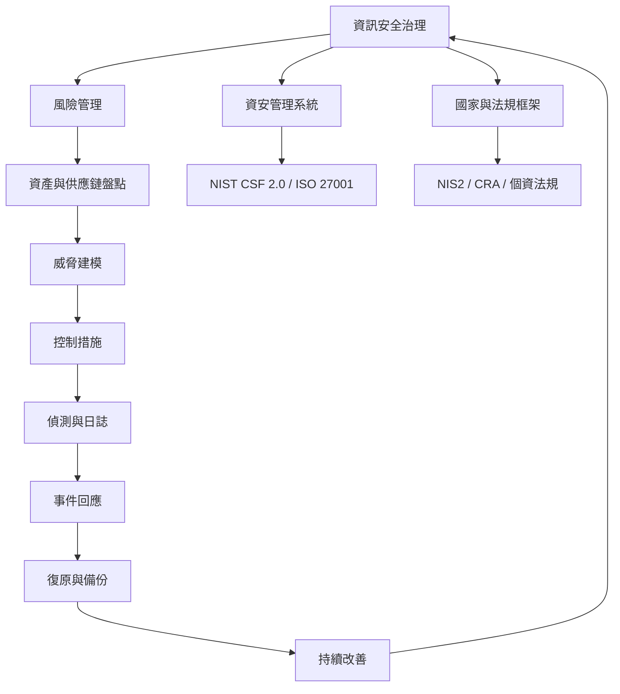

組織治理回答誰負責、如何配置資源、何時接受風險，以及事故時如何協調。資安韌性則將治理承諾轉化成預防、偵測、回應、復原和學習的能力。

## 關係圖

治理不是流程圖最上方的抽象標籤，而是決定資安工作有沒有預算、決策權、支援與問責。事件回應也不是單次技術任務，它必須回饋到風險盤點與管理系統，讓組織從事故中調整。

## 思與行
* 把管理階層責任、供應商契約、風險接受、事故通報、備份還原與改善責任放到同一張治理圖。
* 每年至少演練一次由高層參與的重大事故決策，而不只測試 SOC 或工程團隊。

## 參考
* [[以治理為起點的 NIST CSF 2.0 將資安視為持續風險管理]]、[[事件回應應融入整體資安風險管理]]、[[ISO 27001 把資訊安全轉化為可持續改善的管理系統]]。
