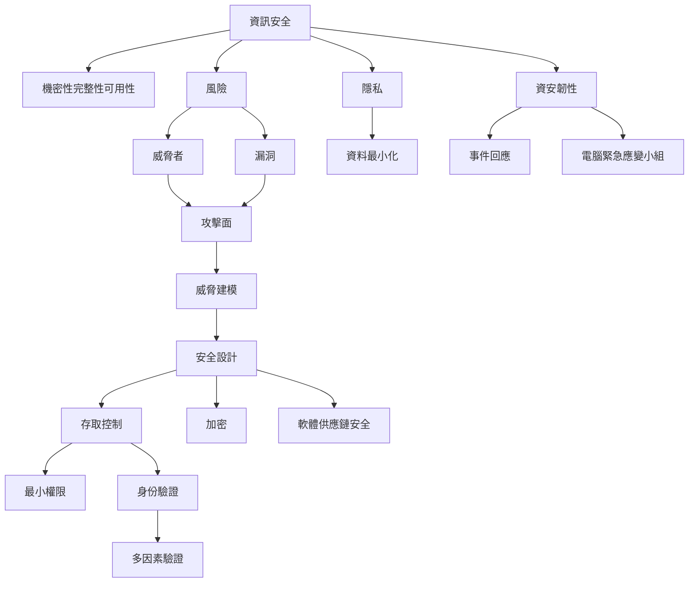

資訊安全可以從保護目標、威脅情境、控制設計和持續治理四個面向理解。核心不是堆疊工具，而是先辨識資產與風險，再選擇符合情境的安全控制，並持續偵測、回應與復原。

## 關係圖

這張圖把概念連成一條可反覆使用的思考路徑：先確定資訊安全的保護目標，再找出風險、威脅者和弱點，透過威脅建模形成設計決策，最後以韌性能力處理不可避免的失效。隱私和資料最小化則提醒保護不只在於防止外部攻擊，也包括避免組織過度收集與使用資料。

## 思與行
* 以此圖檢查一個實際服務是否有資產、威脅模型、最小權限、供應鏈清冊、隱私評估和事件回應。
* 由 [[威脅建模]] 到 [[安全設計]]，再到 [[資安韌性]]，作為系統設計與維運的閱讀順序。

## 參考
* NIST CSF 2.0、Saltzer & Schroeder 1975、NIST SP 800-207、OWASP Top 10:2025。
