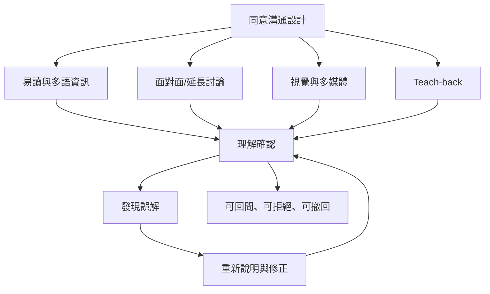

同意流程的品質取決於參與者能否實際理解及自由決定。研究顯示，改善文件、延長討論、教學式確認與多媒體工具各有適用情境；沒有任何單一介入能在所有場景自動保證理解。

研究：[[同意文件加上對話與理解測試通常比單純加長文件更有效]]、[[臨床試驗參與者對隨機分派與安慰劑的理解尤其容易不足]]。

概念：[[理解]]、[[資訊揭露]]、[[持續同意]]。

延伸至全書：[[Informed_consent]]。
