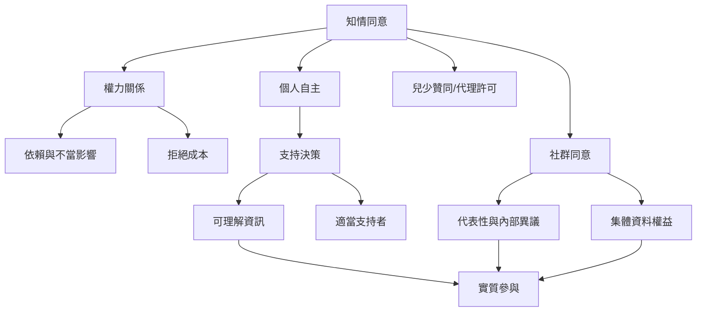

知情同意的形式可能掩蓋結構性限制。兒少、身心障礙者、病人、受雇者、被拘禁者與邊緣化社群，可能因依賴關係或制度權力而難以拒絕。公平的同意需要支持決策、尊重個人拒絕，並在涉及集體權利時加入社群治理。

主要論點：[[自願性必須從拒絕與退出的真實成本來判斷]]、[[代理決策應盡量保留當事人的意願與參與]]、[[社群同意與個人同意應並行而不能互相取代]]。

概念：[[權力不對等]]、[[支持決策]]、[[兒少贊同]]、[[代理決策]]、[[社群同意]]。

延伸至全書：[[Informed_consent]]。
