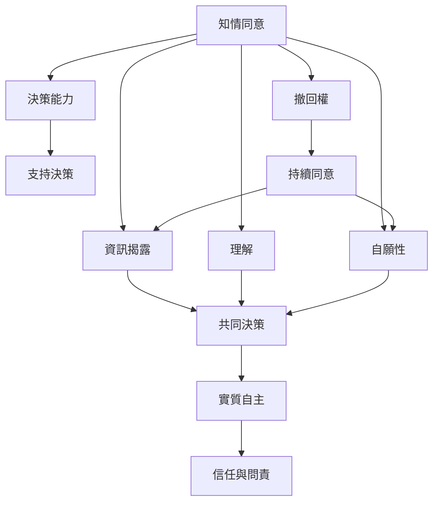

知情同意的核心不是單一法律文件，而是由資訊、理解、自願、決策能力與撤回權組成的倫理流程。這張地圖呈現其基本要件與制度支撐。

核心概念：[[知情同意]]、[[自主]]、[[資訊揭露]]、[[理解]]、[[自願性]]、[[決策能力]]、[[撤回權]]、[[共同決策]]。

實作論點：[[知情同意是一段持續對話而不是一次簽署]]、[[理解比簽名更能證明同意程序有效]]、[[自願性必須從拒絕與退出的真實成本來判斷]]。

延伸至全書：[[Informed_consent]]。
