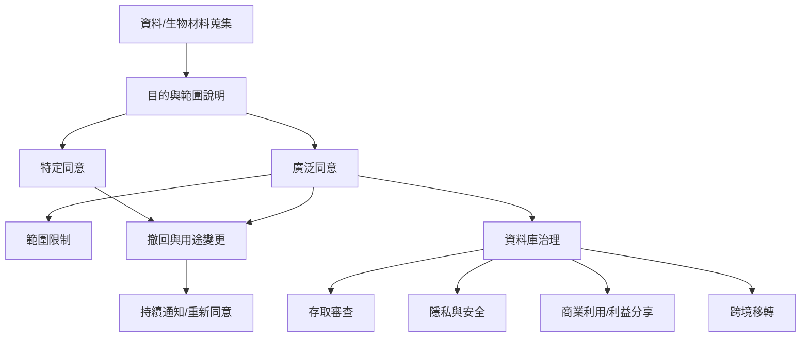

資料與生物材料的長期保存，使同意超越一次研究或單一醫療處置。未來用途、資料連結、跨境分享、商業利用與撤回可行性都需要被說明；同意制度也必須由透明治理與問責支撐。

主要來源：[[台北宣言提醒生物資料庫同意必須涵蓋長期使用與治理]]、[[加拿大TCPS2允許受限制的廣泛同意但不接受空白授權]]、[[歐盟GDPR要求資料處理同意自由具體知情且明確]]。

概念：[[資料治理]]、[[隱私]]、[[生物資料庫]]、[[廣泛同意]]、[[動態同意]]、[[撤回權]]。

延伸至全書：[[Informed_consent]]。
