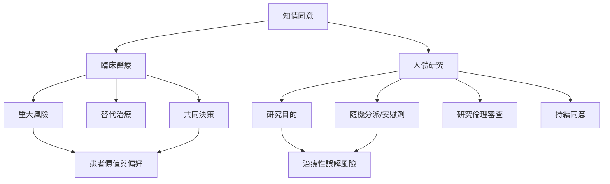

醫療照護與人體研究共享尊重自主的原則，但目標、風險結構與法律要求並不完全相同。醫療同意聚焦患者面對的處置選項；研究同意則必須清楚區分知識生產與個人照護，並接受獨立倫理審查。

相關資料：[[台灣醫療法第63與64條要求特定處置前說明並取得同意]]、[[英國Montgomery判決將重大風險的揭露連結到患者觀點]]、[[赫爾辛基宣言2024版是人體醫學研究的重要國際倫理文本]]、[[貝爾蒙報告將知情同意拆成資訊、理解與自願三個要素]]。

概念：[[共同決策]]、[[治療性誤解]]、[[研究倫理審查]]、[[決策能力]]。

延伸至全書：[[Informed_consent]]。
