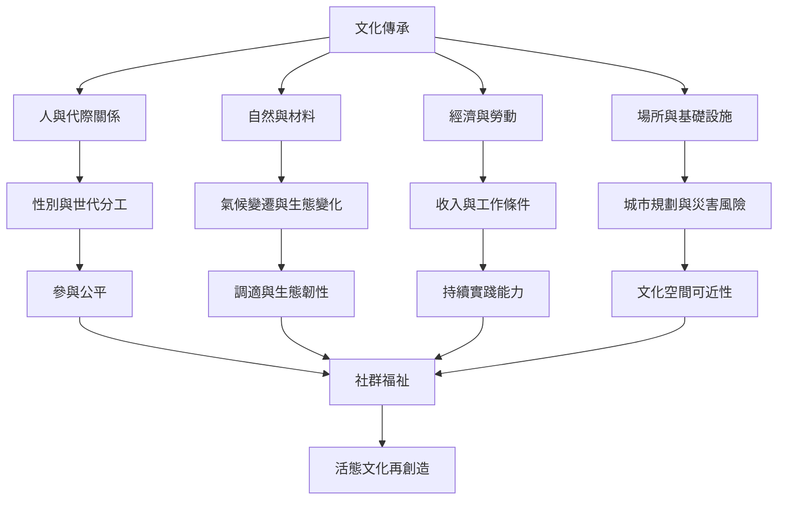

此圖聚焦文化實踐與環境變化、性別分工、經濟條件及緊急情境之間的相互依賴。保存成效需要回到社群生活條件，而不是只計算活動或登錄數量。

[[文化傳承與生態環境及氣候韌性相互依賴]]、[[性別與世代關係會決定誰能傳承誰能代表文化]]、[[緊急情境下保護文化必須以人的安全與社群復原為核心]] 構成這張地圖的三個主要面向。

案例參照：[[日本和食把食材季節與自然觀納入飲食文化]]、[[韓國泡菜共作與分享文化把飲食實踐連結家庭互助與季節循環]]、[[摩洛哥傑馬艾夫納廣場的文化生命依賴日常公共空間]]。延伸地圖：[[活態遺產系統地圖]]。
