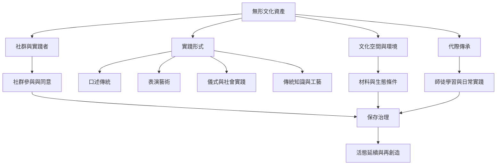

此圖將無形文化資產理解為由實踐者、技能、空間、材料、記憶、制度與環境共同構成的系統。它不是項目清單，而是用來追問文化實踐如何維持、改變與再生。

[[無形文化資產是被實踐而非被收藏的活態關係]] 說明實踐關係的基礎；[[保存的目標是維持文化實踐的可持續性而非複製原貌]] 將此基礎轉化為保存目標；[[文化傳承依賴日常場所物件經濟與照顧勞動]] 則描繪支撐條件。

相關概念：[[無形文化資產]]、[[活態遺產]]、[[文化傳承]]、[[文化空間]]、[[傳統知識]]、[[傳統工藝]]。延伸地圖：[[無形文化資產治理與權力地圖]]、[[傳承與生態社會韌性地圖]]、[[研究記錄與數位倫理地圖]]。
