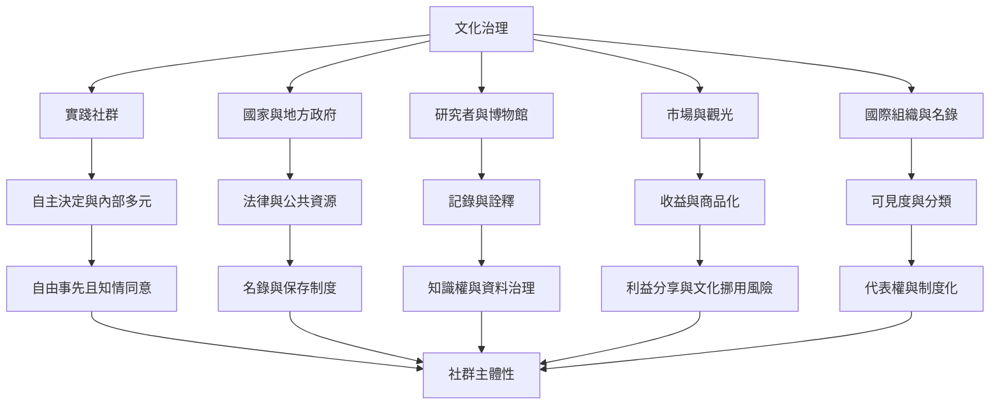

此圖將文化保存視為多方治理與權力協商：社群、國家、研究者、媒體、市場和國際組織可能提出不同的文化定義與利益。治理品質取決於決策權、同意、資源與收益如何分配。

[[社群應是文化傳承治理的主體而非被研究對象]] 是治理原則；[[名錄提高可見度卻也把流動文化轉成可管理項目]] 與 [[遺產作為文化過程的批判研究改變保存問題的問法]] 解析制度效果；[[傳統知識與文化表達需要不同於公共領域假設的權利保護]] 連結智慧財產權議題。

相關概念：[[社群參與]]、[[自由事先且知情同意]]、[[文化權利]]、[[名錄化]]、[[文化挪用]]、[[文化商品化]]、[[文化遺產治理]]。延伸地圖：[[活態遺產系統地圖]]、[[研究記錄與數位倫理地圖]]。
