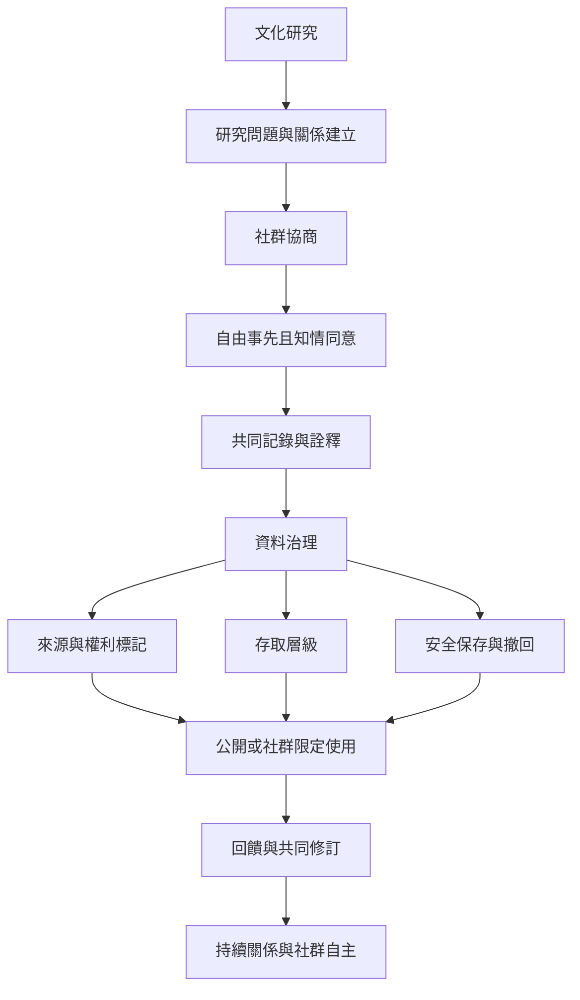

此圖整理研究者如何接近文化實踐、協商同意、記錄資料、管理存取與回饋社群。資料保存不等於自動公開；研究倫理應貫穿研究前、中、後的整個生命週期。

[[研究者必須先協商知情同意與回饋再記錄文化]] 提供研究流程；[[數位典藏必須同時治理存取權與文化敏感度]] 處理資料治理；[[傳統知識與文化表達需要不同於公共領域假設的權利保護]] 連接權利保護問題。

相關概念：[[自由事先且知情同意]]、[[數位典藏]]、[[傳統文化表達]]、[[文化權利]]。延伸地圖：[[無形文化資產治理與權力地圖]]。
