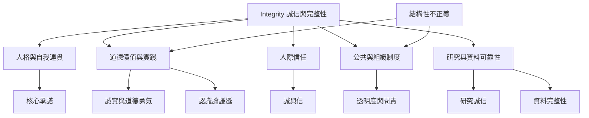

Integrity 可以視為五個互相連結、但不可混同的層次：人格的自我連貫、道德價值的可辯護性、人際關係中的可信賴、組織與公共制度的問責，以及知識與資料的完整可追溯。不同層次彼此借用「完整、可靠、未被扭曲」的意象，但適用標準各不相同。

閱讀時先由 [[道德完整性]] 理解個人層次，再看 [[公共誠信]] 與 [[研究誠信]] 如何制度化，最後以 [[資料完整性]] 檢查「完整」如何成為可操作標準。批判面向可參照 [[結構性不正義]] 與 [[道德授權]]。

## 思與行
* 每當使用 Integrity 一詞，先標明談的是人格、關係、制度、研究還是資料，避免跨層次偷換概念。
* 在討論個人品格時，額外檢查價值是否公正；在討論制度時，額外檢查權力與申訴管道。

## 參考
* 綜合 [[完整性同時涉及人格自我關係與規範判斷]]、[[OECD公共誠信框架強調全政府與全社會共同治理]]、[[新加坡宣言把研究誠信整理為誠實問責公平與善盡管理]]、[[資料完整性要求資料在整個生命週期保持可追溯]]。
