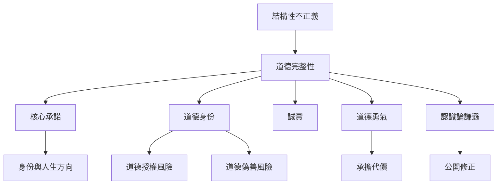

個人層次的 Integrity 不是一套不可改變的自我形象，而是人在核心承諾、道德判斷、情感、行動與關係之間持續整合的實踐。它需要承諾提供方向，也需要謙遜與回應能力避免承諾僵化。

核心閱讀順序：[[一致性只有在價值可受檢驗時才具有道德意義]] → [[承諾能支撐身份卻不應凌駕受害者]] → [[道德身份不能代替具體行為的持續檢查]] → [[誠信不是從不犯錯而是能公開修正]]。

## 思與行
* 做自我反思時同時記錄內在意圖、具體行為與對他人的影響。
* 把改變立場視為可能的誠信實踐，而非自動視為反覆無常。

## 參考
* 哲學與心理研究見 [[完整性同時涉及人格自我關係與規範判斷]]、[[道德完整性也可能成為核心承諾與功利計算的衝突]]、[[道德身份可能促成道德行為也可能誘發道德自我合理化]]。
