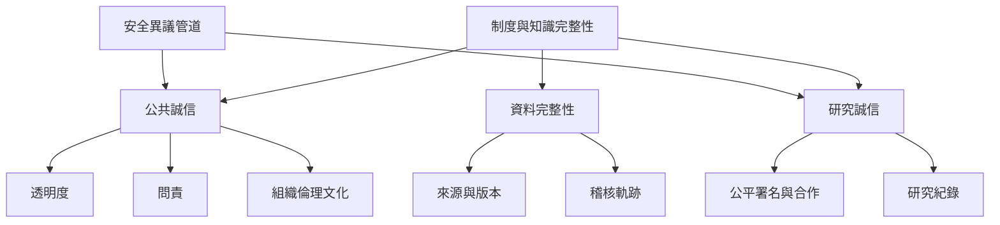

制度與知識層次的 Integrity，重點不是宣稱組織或資料「值得信任」，而是建立讓承諾能被查驗、錯誤能被發現、責任能被追究、修正能被保存的程序。公共治理、研究協作與資料管理各有專屬規範，但都需要明確角色、透明流程與公平回應。

## 思與行
* 將每一項制度承諾翻譯成流程、責任人、紀錄方式與申訴管道。
* 以錯誤更正能力衡量制度成熟度，而不是只計算零違規或成功案例。

## 參考
* 依據 [[OECD公共誠信框架強調全政府與全社會共同治理]]、[[新加坡宣言把研究誠信整理為誠實問責公平與善盡管理]]、[[蒙特婁宣言將跨界研究誠信視為共同責任]]、[[資料完整性要求資料在整個生命週期保持可追溯]]。
