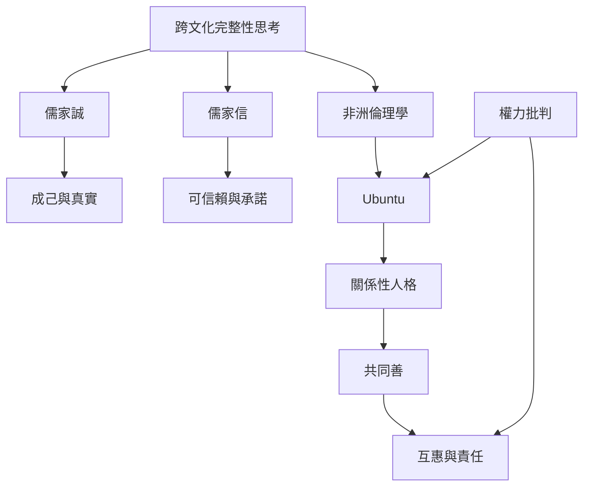

跨文化閱讀不應尋找一個英文詞的完美對譯，而應比較各傳統如何理解真實、自我修養、承諾、共同善與社會責任。儒家「誠／信」提供內在真實與可靠行動的互補視角；非洲倫理學的部分思想強調關係、人格形成與共同生活；兩者都需要放回其歷史、語言與內部差異中理解。

## 思與行
* 引用文化概念時，註明語言、思想家、文本與歷史脈絡。
* 同時追問共同善如何避免變成要求弱勢者沉默的理由。

## 參考
* 依據 [[儒家之誠重在真實完成自身而不只是口頭誠實]]、[[儒家之信要求言語可被信賴並經由實踐判斷]]、[[非洲倫理學常以品格、關係與共同善理解道德生活]]、[[Ubuntu在全球AI倫理中的使用也需要批判與政治化]]。
