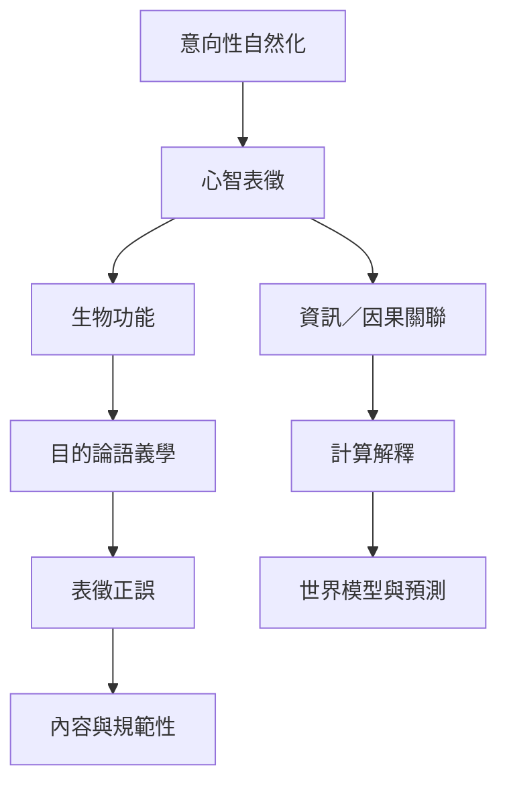

自然化理論試圖說明心智內容如何在自然世界中成立。資訊與因果理論解釋訊號如何與世界連動；目的論理論以功能和可失敗性處理表徵正誤；計算論與外在論則補充內容如何依賴學習、身體及環境。主要難題是資訊關聯何以成為真正的語義內容。

概念交會：[[意向性]]、[[心智表徵]]、[[意向內容]]、[[原初意向性]]、[[派生意向性]]、[[自然化意向性必須處理資訊與語義之間的落差]]、[[生物功能理論試圖以可失敗的功能解釋表徵內容]]
