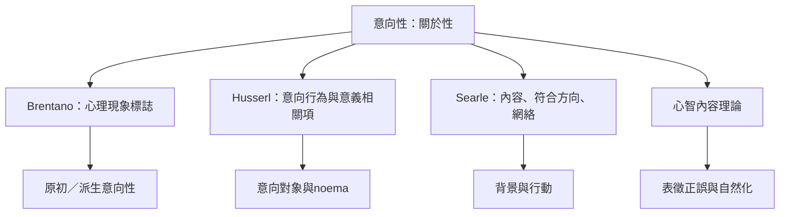

這張地圖從核心定義出發，連接 Brentano 的心理標誌論、Husserl 的現象學分析、Searle 的意向狀態網絡，以及內容理論對表徵正誤的解釋。閱讀時先區分「關於性」、「意圖」與「意向對象」，再比較不同理論究竟是在描述經驗、分析語義，還是提出心智的本體論。

概念交會：[[意向性]]、[[意圖]]、[[關於性]]、[[意向對象]]、[[意向內容]]、[[意向行為]]、[[noesis]]、[[noema]]、[[意向內存]]、[[符合方向]]、[[原初意向性]]、[[派生意向性]]
