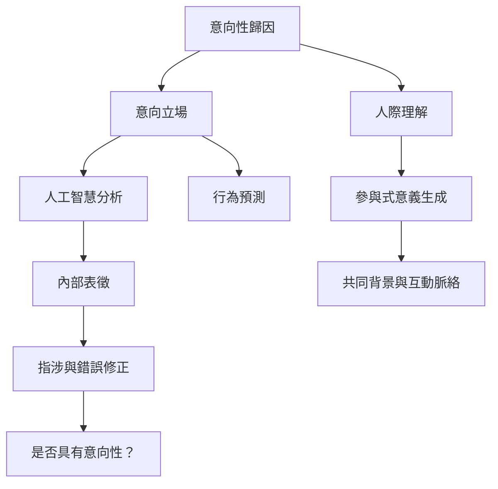

意向性歸因既是理解他人的方法，也是理解人工系統的策略。社會互動論指出意義可在互動中生成；Dennett 的意向立場則說明信念與欲望語言如何幫助預測行為。對 AI 的判斷還需加入指涉可靠性、錯誤修正、世界接地與概念延伸的成本。

概念交會：[[意向立場]]、[[參與式意義生成]]、[[意義生成]]、[[派生意向性]]、[[原初意向性]]、[[大型語言模型出現類似意圖的表徵但不等於具有人的意圖]]、[[意向性歸因應保留對他者的修正空間]]
