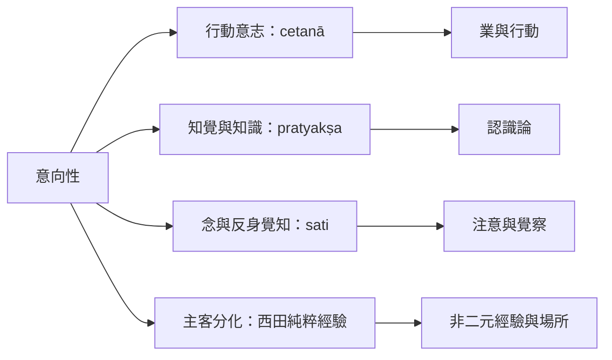

此地圖以比較問題而非概念對譯為原則。cetanā 著重意志與業，sati 涉及念與覺察，pratyakṣa 處理知覺與有效知識；西田純粹經驗則挑戰主客二分。它們可與意向性對話，但不能被還原成西方哲學同一術語。

概念交會：[[意向性]]、[[cetanā]]、[[sati]]、[[pratyakṣa]]、[[意圖]]、[[正念練習可區分注意對象與反身覺知]]、[[東亞非二元經驗論能質疑主客二分的預設]]
