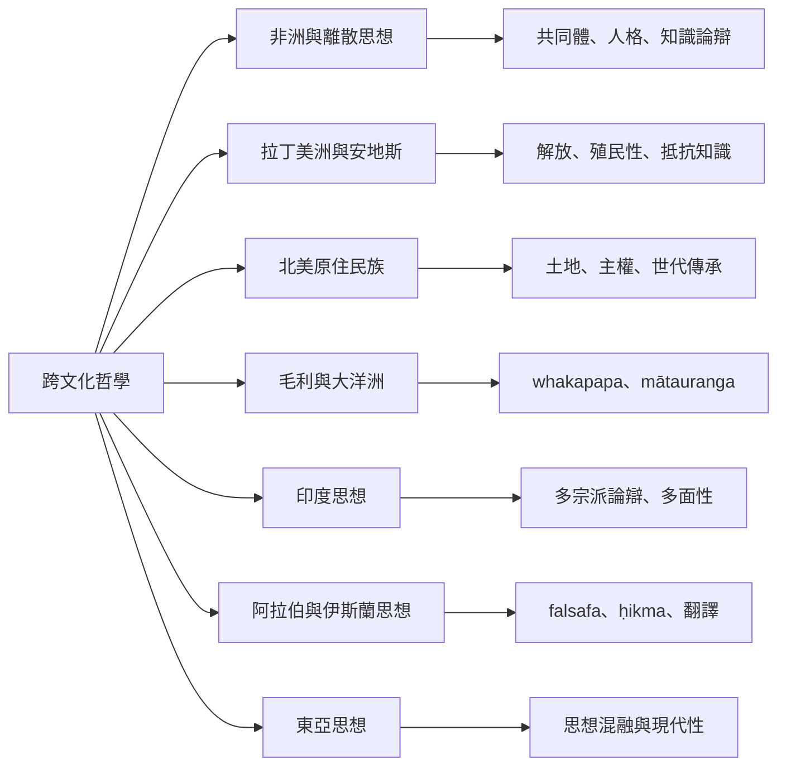

全球思想場域不是以「東方／西方」二分即可理解。非洲哲學、拉丁美洲解放哲學、安地斯思想、北美與大洋洲原住民族知識、印度多宗派論辯、阿拉伯／伊斯蘭哲學，以及東亞思想的跨文化生成，都具有內部多樣性與歷史交錯。地區只是研究起點，不能被當成固定思想本質。

可閱讀 [[非洲哲學包含多種論辯傳統而非單一非洲世界觀]]、[[Ubuntu的關係倫理必須同時容納共同性與差異]]、[[拉丁美洲解放哲學把受壓迫者的歷史經驗帶回哲學中心]]、[[安地斯知識實踐揭示了抵抗性認識論的日常基礎]]、[[北美原住民族知識把土地與世代傳承視為認識條件]]、[[毛利 mātauranga Māori 是具有哲學反思能力的知識傳統]]、[[whakapapa把毛利哲學理解為跨世代與跨物種的關係網]]、[[印度哲學史中的論辯實踐早已發展出多聲部立場]]、[[阿拉伯哲學的希臘來源不能遮蔽其伊斯蘭思想脈絡]]、[[當代伊斯蘭哲學仍是活躍的跨學科思想實踐]] 與 [[京都學派與新儒家顯示文化傳統本身就是混融生成]]。

## 延伸連結
* [[文化傳統是持續變動的論辯場而非固定本質]]
* [[不同傳統內部的論辯比文明標籤更能呈現思想多樣性]]
* [[為每個哲學傳統製作內部爭論地圖以避免文化本質化]]
