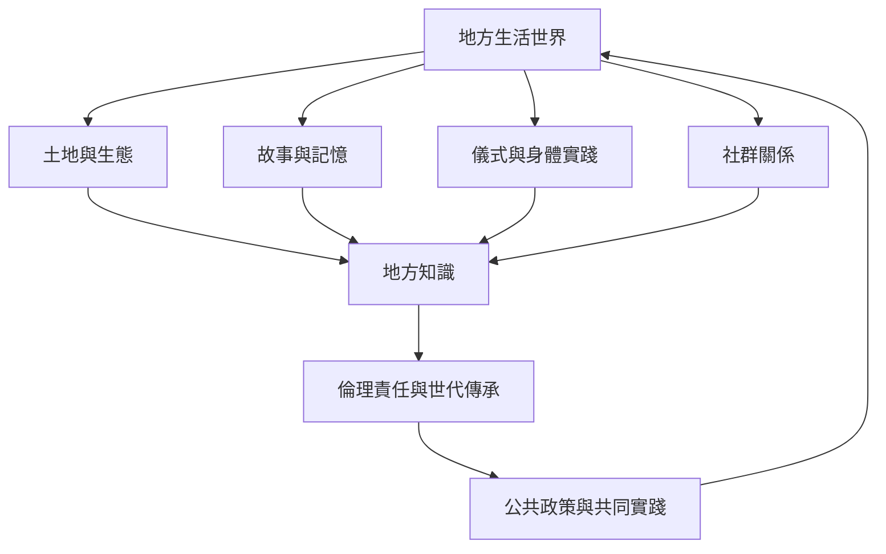

跨文化哲學不只比較抽象概念，也要理解知識如何存在於地方、土地、故事、儀式、照護與共同生活。原住民族知識與地方實踐提醒我們，認識論、存在論、倫理與政治常常彼此交織。關係倫理也不能被簡化成群體和諧，而必須檢驗權力、差異、異議與非人世界的責任。

可連結 [[知識可以存在於土地故事與共同實踐之中]]、[[關係倫理必須保留群體內部的差異與異議]]、[[北美原住民族知識把土地與世代傳承視為認識條件]]、[[安地斯知識實踐揭示了抵抗性認識論的日常基礎]]、[[whakapapa把毛利哲學理解為跨世代與跨物種的關係網]]、[[Ubuntu的關係倫理必須同時容納共同性與差異]]。

## 延伸連結
* [[以地方日常實踐檢驗抽象的關係倫理]]
* [[讓知識來源社群共同審閱跨文化研究成果]]
* [[設計一門從共同問題出發的世界哲學閱讀課]]
