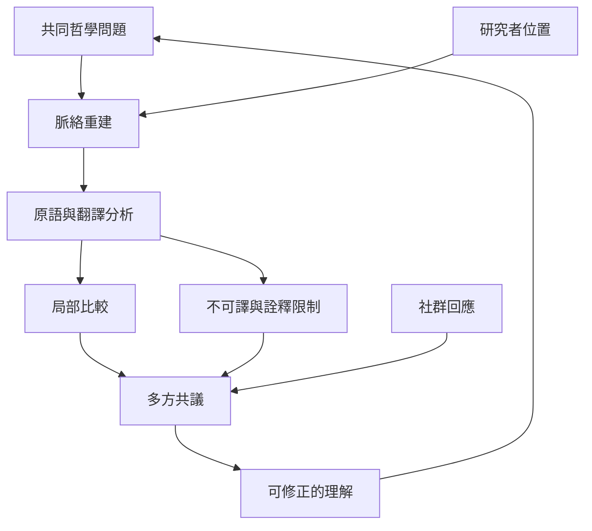

跨文化哲學的核心不是把文化分成固定單位，而是讓多個思想傳統共同處理哲學問題。研究者需要先界定研究問題，再重建各傳統的文本與生活脈絡，接著透過翻譯、比較、詮釋與多方共議形成可修正的理解。方法論的風險包括文化中心主義、過度簡化、假裝完全可譯，以及把差異浪漫化成不可批判。

可從 [[跨文化哲學以共同問題連結不同語言與思想傳統]]、[[比較必須先重建概念所在的歷史與實踐脈絡]]、[[翻譯不是替換詞語而是重建概念脈絡]]、[[概念不可通約不代表思想之間不能建立局部比較]]、[[跨文化哲學應從雙邊比較走向多方共議]] 進入。核心術語包括 [[跨文化哲學]]、[[比較哲學]]、[[多方共議]]、[[位際詮釋]]、[[詮釋學]]、[[可通約性]]、[[不可通約性]] 與 [[跨文化生成]]。

## 延伸連結
* [[跨文化哲學必須先檢視自身文化中心主義]]
* [[Panikkar的跨文化詮釋要求研究者讓自身世界觀也接受轉化]]
* [[世界哲學與比較哲學的任務不同但彼此互補]]
* [[以三方共議工作坊取代文明二分式的哲學比較]]
* [[建立原語詞彙卡以追蹤概念在翻譯中失去的內容]]
