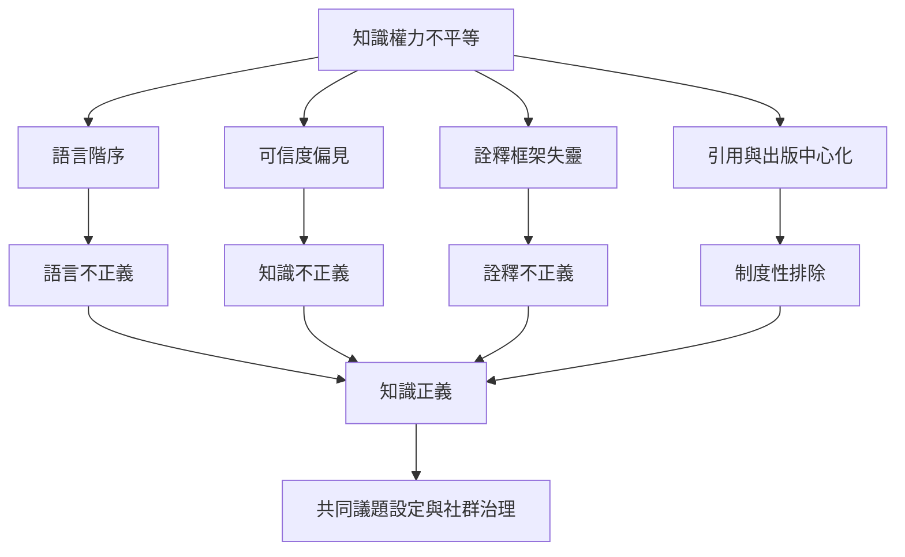

跨文化哲學必須追問：誰的語言被視為知識語言、誰能決定研究問題、誰的經驗能被理解、誰擁有詮釋權，以及誰能從研究與出版中獲益。知識不正義可能發生在可信度分配、翻譯框架、學術引用、資料治理與制度參與等層面。去殖民化不是只增加代表性，而是改變這些權力關係。

核心連結包括 [[知識正義需要重新分配研究資源與解釋權]]、[[去殖民化不只是擴充經典名單而是重分配知識權力]]、[[翻譯中的語言不平等會限制誰能參與哲學]]、[[跨文化知識差異可能因翻譯框架失靈而形成詮釋不正義]]、[[世界哲學的全球化必須同時改造引用與學術制度]]、[[跨文化對話需要制度支持而不只是善意交流]]。

## 延伸連結
* [[哲學知識的全球流通需要公平的語言制度]]
* [[全球化女性主義要求把知識放回具體的殖民與生活位置]]
* [[讓知識來源社群共同審閱跨文化研究成果]]
* [[以研究者位置聲明讓跨文化詮釋保持可檢驗]]
