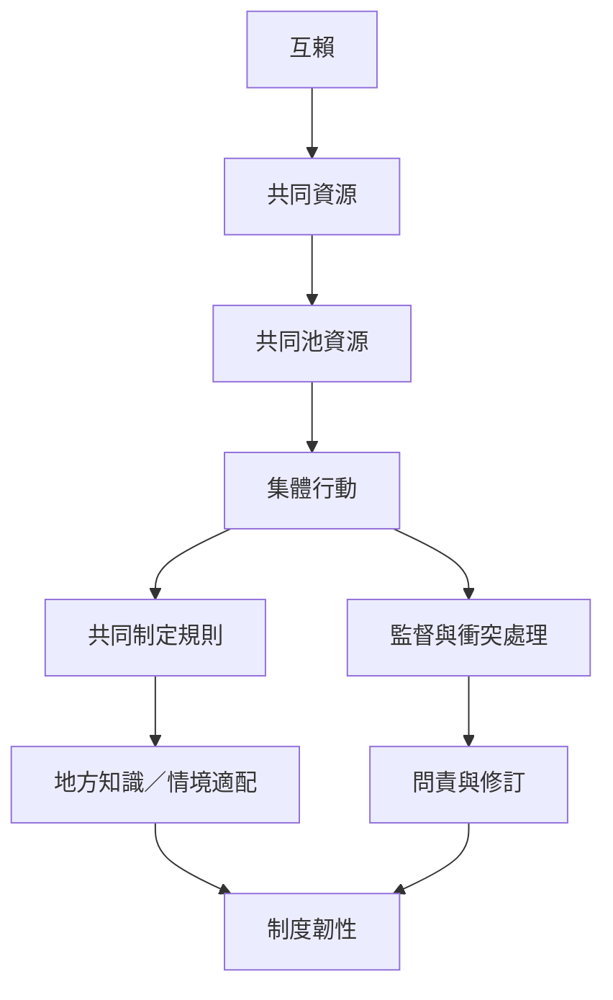

本地圖聚焦互賴如何成為可持續的制度安排。共同池資源會引發使用、維護與分配問題；集體行動需要使用者制定規則、監督、處理衝突並修訂制度。Ostrom 的研究顯示，市場或國家並非唯一治理途徑，地方社群也能發展多層次制度。

**閱讀連結**：[[共同資源]]、[[共同池資源]]、[[集體行動]]、[[韌性]]、[[社會生態系統]]。

**相關永久筆記**：[[共同資源需要使用者參與制定與執行規則]]、[[可信任的社群要同時培養照顧能力與衝突處理]]。
