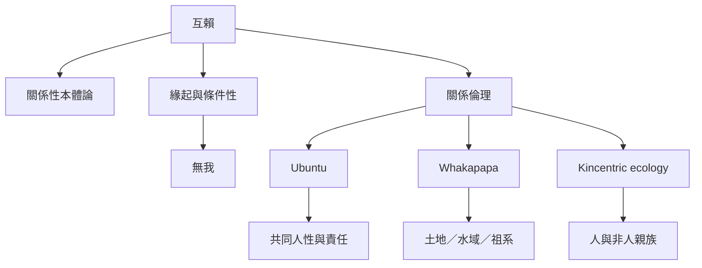

本地圖整理互賴作為存在觀與倫理觀的幾條思想路徑：佛教緣起著重條件性與苦的止息；Ubuntu、Māori whakapapa 與 kincentric ecology 各自置於不同歷史文化脈絡，呈現關係性人格、譜系與人—非人親屬關係。這些傳統可以對話，但不應被抹平成同一套「萬物一體」教義。

**閱讀連結**：[[互賴]]、[[關係性本體論]]、[[緣起]]、[[無我]]、[[Ubuntu]]、[[Whakapapa]]、[[Kincentric ecology]]。

**相關永久筆記**：[[任何生命都先在關係中形成而非先成為孤立個體]]、[[看見依存條件比宣稱萬物相連更能辨認實際因果]]、[[生態互賴提醒人類是共同生活系統的一員]]。
