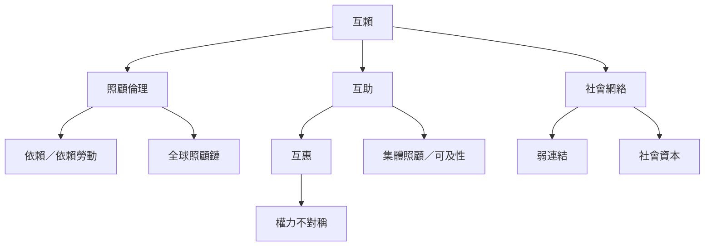

本地圖從日常關係切入：互賴透過照顧、互助、互惠及社會網絡具體發生。照顧倫理提醒公共制度如何分配照顧責任；身心障礙正義把可及性與集體支持納入自由；弱連結則讓資訊跨越熟人圈。互助能否公平，仍取決於界線、資源與權力安排。

**閱讀連結**：[[照顧倫理]]、[[依賴]]、[[依賴勞動]]、[[全球照顧鏈]]、[[互助]]、[[互惠]]、[[社會網絡]]、[[弱連結]]、[[社會資本]]。

**相關永久筆記**：[[照顧是社會再生產基礎不應只由家庭私人吸收]]、[[弱連結讓互賴網絡具備跨群體學習能力]]、[[互惠只有在交換規則可協商時才不會固化成債務]]。
