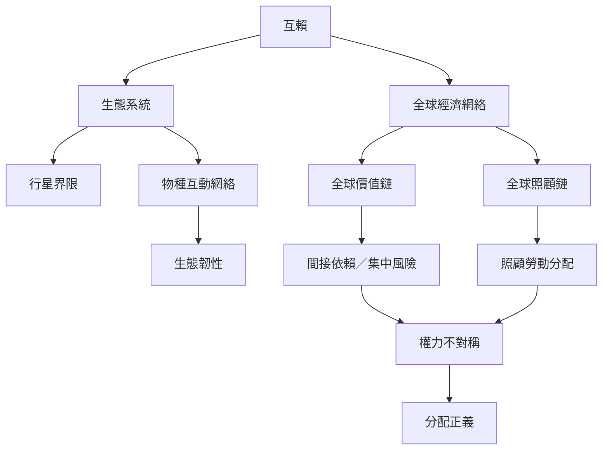

本地圖將互賴擴展到生態系統與全球生產網絡。生態網絡與行星界限相互作用；全球價值鏈和全球照顧鏈則把資源、勞動與風險跨境傳導。互賴可以創造共同利益，也可能形成集中風險與不平等分工，必須同時分析韌性和正義。

**閱讀連結**：[[社會生態系統]]、[[韌性]]、[[全球價值鏈]]、[[全球照顧鏈]]、[[權力不對稱]]。

**相關永久筆記**：[[生態互賴提醒人類是共同生活系統的一員]]、[[全球互賴既帶來合作機會也形成風險傳導]]、[[互賴的倫理品質取決於權力是否可被看見與制衡]]。
