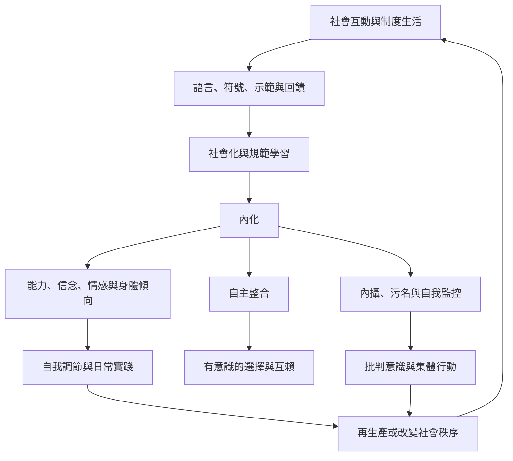

內化可以從四個互相連結的層次理解：發展心理學關注能力如何從互動轉成個人調節；社會學關注制度化世界如何成為主觀現實；動機理論關注外在規範是否被自主整合；批判與權力理論則追問內化如何使支配延續，以及人如何重新協商它。

## 關係圖

## 概念連結
[[內化]]連結[[社會化]]、[[文化傳遞]]與[[規範學習]]；其發展歷程可從[[維高斯基指出高階心理功能先存在於人際關係再成為個人能力]]理解，社會世界如何成為主觀現實則見[[Berger與Luckmann說明內化如何使社會世界成為主觀現實]]。內化的品質可由[[內攝]]、[[認同調節]]與[[整合調節]]區分；權力面向則連到[[習性]]、[[象徵暴力]]、[[規訓]]與[[內化污名]]。

延伸脈絡：[[Internalization]]
