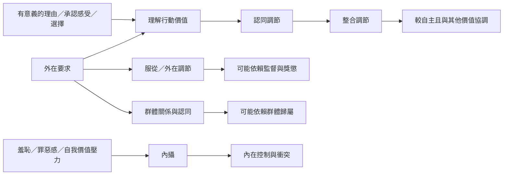

本圖聚焦一個核心問題：外在要求如何從被迫遵守，逐漸轉為個人認可的行動理由？Kelman 的社會影響模型與自我決定理論相關但不相同，應保留各自分類的理論意義。

## 關係圖

## 概念連結
[[服從]]、[[認同]]、[[內攝]]、[[認同調節]]與[[整合調節]]是理解動機品質的基本詞彙。相關研究見[[Kelman將社會影響區分為服從認同與內化]]與[[自我決定理論區分內攝認同與整合三種不同的規範內化]]。

延伸脈絡：[[Internalization]]
