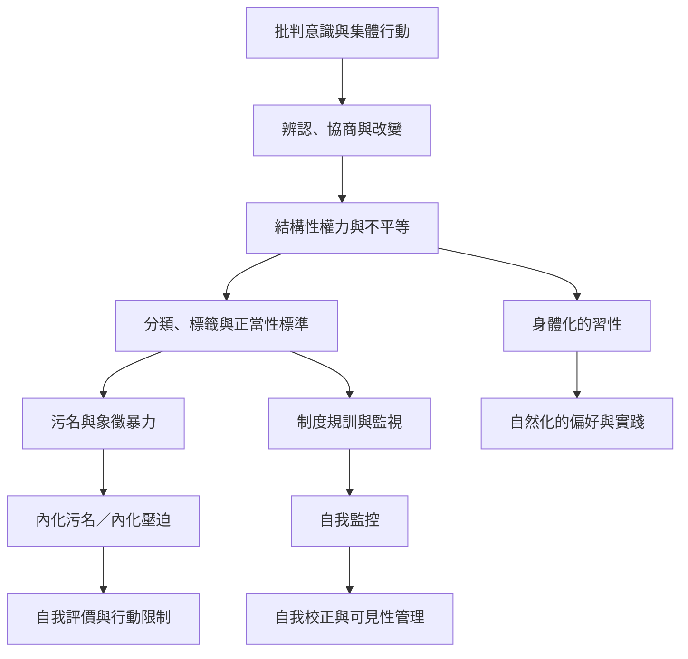

權力不必只透過明確命令運作。分類、可見性、評量與資源分配可能使某些標準成為常識，再透過身體習性、自我監控或負面自我評價延續。這些機制互有關聯，但不可全部化約成同一種內化。

## 關係圖

## 概念連結
[[污名]]、[[內化污名]]、[[內化壓迫]]、[[象徵暴力]]、[[習性]]、[[規訓]]與[[自我監控]]構成本圖核心。經典與案例可參考[[Freire指出受壓迫者可能把壓迫者的形象與尺度帶進自我理解]]、[[Fanon分析殖民分類如何沉積為自我價值與身分衝突]]及[[印度達利特社群的研究呈現污名內化與身分協商並非單一路徑]]。

延伸脈絡：[[Internalization]]
