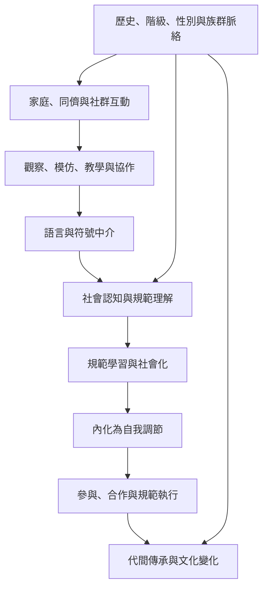

內化的發展始於共同生活。兒童在互動中學習語言、符號、意圖與行為規範，並逐步能運用文化工具調節自身行動。不同社群共享部分社會認知能力，但學習內容、情境與規範的正當性需要在地方脈絡中理解。

## 關係圖

## 概念連結
[[社會化]]、[[文化傳遞]]與[[規範學習]]是本圖的核心概念。實證討論見[[跨文化發展研究指出社會認知具有共通性也具有文化差異]]、[[種族社會化研究顯示文化訊息會形塑兒童的群體理解]]與[[社會規範研究把內化放進規範形成傳播與改變的循環]]。

延伸脈絡：[[Internalization]]
