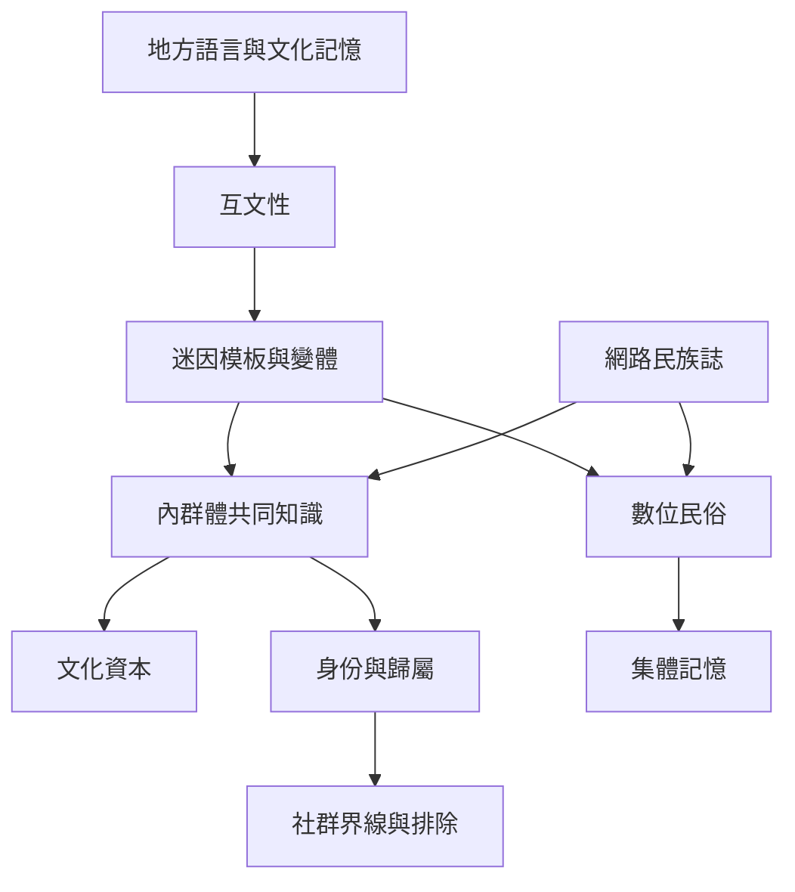

迷因不只傳遞內容，也幫助群體確認彼此的共同知識、立場與情緒。模板和內梗可以成為文化資本與社群界線；互文性使迷因連結到地方歷史與流行文化；數位民俗則提醒我們，迷因延續了日常文化的集體創作和傳承。

核心概念：[[term/數位民俗是透過數位媒介持續形成的群體傳統與表達]]、[[term/文化資本是能轉化為社會優勢的知識技能與品味]]、[[term/互文性是文本意義由其他文本與文化符碼共同形成]]、[[term/網路民族誌透過長期參與理解線上社群的意義與行動]]。

研究時需同時觀察歸屬、排除與地方化，避免把迷因社群浪漫化為沒有權力差異的共同體。
