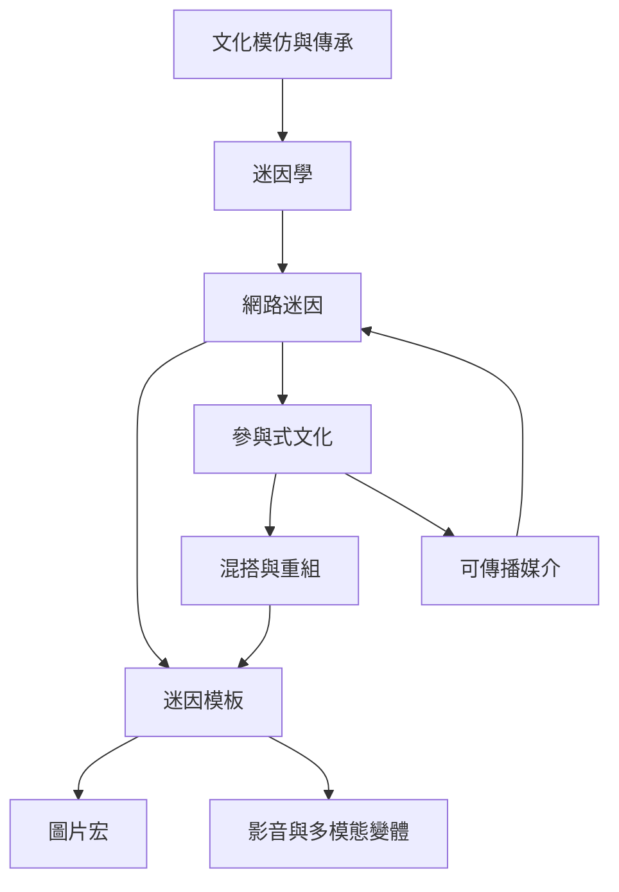

迷因的媒介形式從圖片宏、文字梗到短影音、音源與混合媒體不斷變化，但其核心仍是共享格式、重複引用及集體改寫。理解其演化，需要把文化傳播的理論來源、數位迷因的定義、模板及參與式文化放在一起。

核心概念：[[term/迷因學研究文化資訊如何透過模仿而傳播]]、[[term/網路迷因是由一群相互指涉的數位實例構成]]、[[term/迷因模板是供多人反覆套用與變形的共享形式]]、[[term/圖片宏是將文字疊加在圖像上的數位圖像形式]]、[[term/參與式文化讓受眾同時成為媒體創作者與傳播者]]、[[term/混搭文化透過重新組合既有素材創造衍生作品]]、[[term/可傳播媒介強調受眾如何促成內容流通]]。

本圖是概念整理，不代表所有迷因都必須從圖片宏演化而來。
