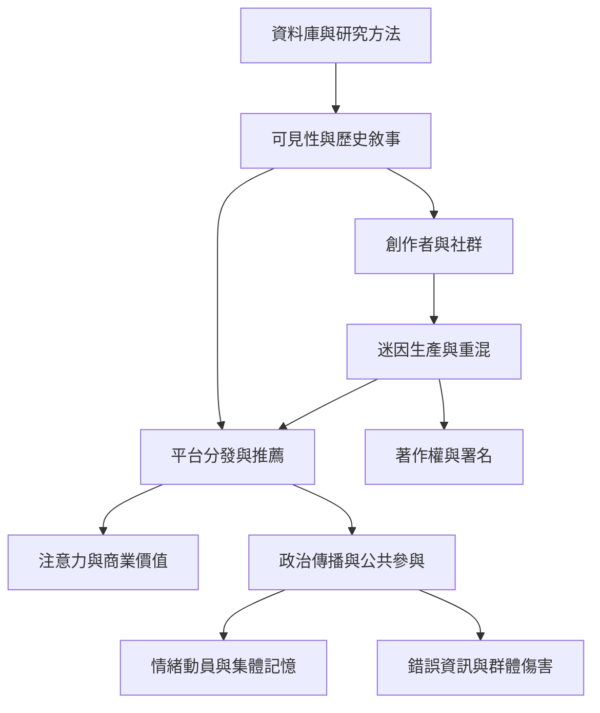

迷因可以促進政治表達與公共參與，也可能傳播偏見、製造錯誤資訊或被平台吸納為商業價值。研究者不只要分析作品，也要分析資料如何被平台與資料庫篩選、社群如何賦予意義、創作者如何勞動，以及重混涉及哪些權利。

核心連結：[[data/新加坡研究顯示政治迷因可能降低政治冷感者的線上參與門檻]]、[[data/迷因流通會把社群文化勞動轉化為平台與廣告價值]]、[[data/迷因重混文化與著作權制度之間存在持續協商]]、[[data/迷因研究必須結合資料分析與創作者的生活脈絡]]、[[data/種族迷因可能把日常偏見包裝成輕鬆的微歧視]]。

研究流程應以平台比較、內容分析、時間序列與數位民族誌互補；倫理上則兼顧查證、隱私、權利與受影響群體的聲音。
