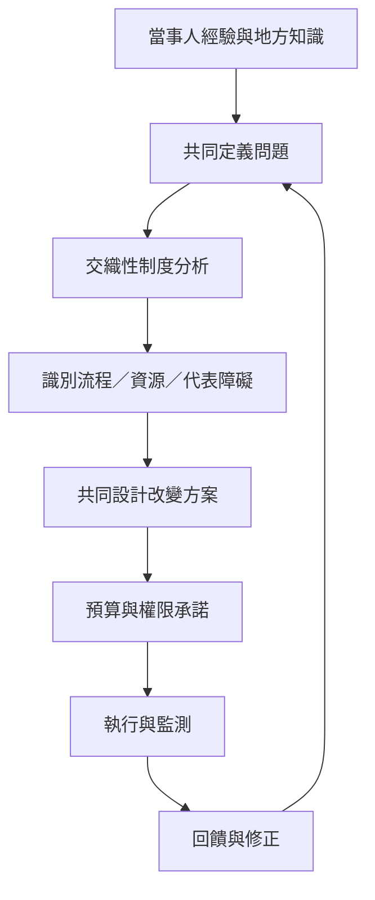

交織性作為批判實踐，需要將分析轉化成制度改革、資源重新分配與當事人決策權。政策或組織若只增加多元象徵、統計更多身份，沒有改變流程、預算、代表方式與問責，便可能把交織性去政治化。

本圖連結 [[term/實質平等]]、[[term/參與式研究]]、[[term/知識不正義]]、[[note/交織性分析應讓受影響者成為共同知識生產者]]、[[idea/把交織性檢核從多元口號改成資源與決策權審計]]。

## 思與行
* 把改善方案寫成可追蹤的責任人、預算、期限、成效與回饋機制。
* 由受影響者參與監測，並確保參與有報酬、有決策權且可退出。

## 參考
* [[data/交織性研究同時包含理論應用學術辯論與政治實踐]]、[[data/Bilge警告學術主流化可能使交織性失去反抗政治]]、[[data/國際人權政策仍常以單一歧視理由處理結構性不平等]]。

參見 [[Intersectionality]]。
