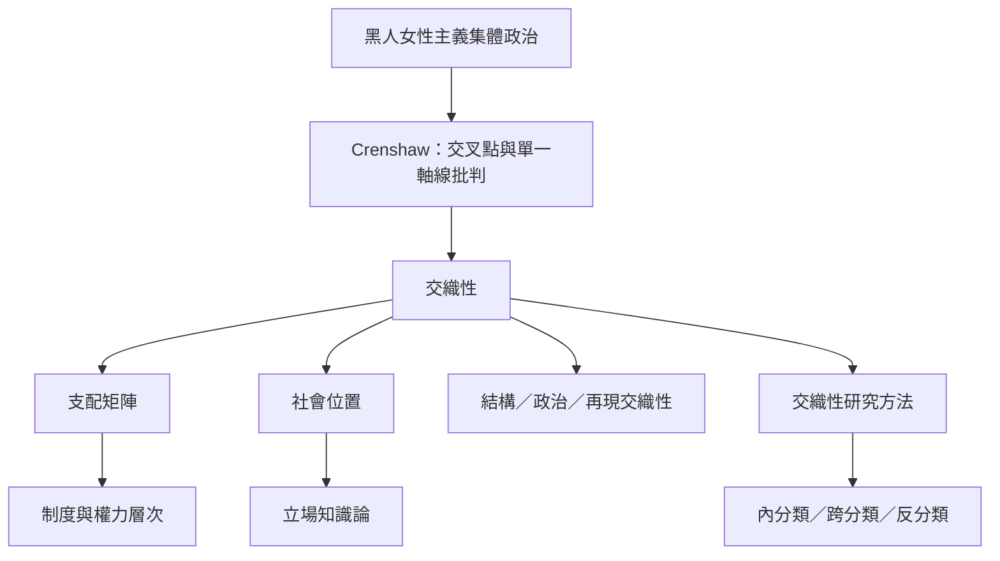

本圖把交織性放回黑人女性主義政治與法律批判的脈絡，並連到支配矩陣、社會位置與分類策略。重點不是尋找唯一的理論定義，而是辨識不同概念如何共同解釋權力、差異與知識生產。

本地圖連結 [[term/交織性]]、[[term/支配矩陣]]、[[term/社會位置]]、[[term/立場知識論]]、[[term/單一軸線分析]]、[[term/內分類式策略]]、[[term/跨分類式策略]]、[[term/反分類式策略]]。

## 思與行
* 先讀集體政治前史，再讀 Crenshaw 法律論文，接著比較 Collins 的支配矩陣與 McCall 的方法分類。
* 每次使用這張圖時，補上當地歷史與制度例子，避免概念圖變成固定且普遍的社會分類表。

## 參考
* [[data/黑人女性主義集體政治在交織性命名前已提出多重壓迫的共同分析]]、[[data/Crenshaw以交叉路口比喻揭露反歧視法的單一軸線盲點]]、[[data/Collins以支配矩陣說明壓迫如何透過多層制度彼此連結]]。

參見 [[Intersectionality]]。
