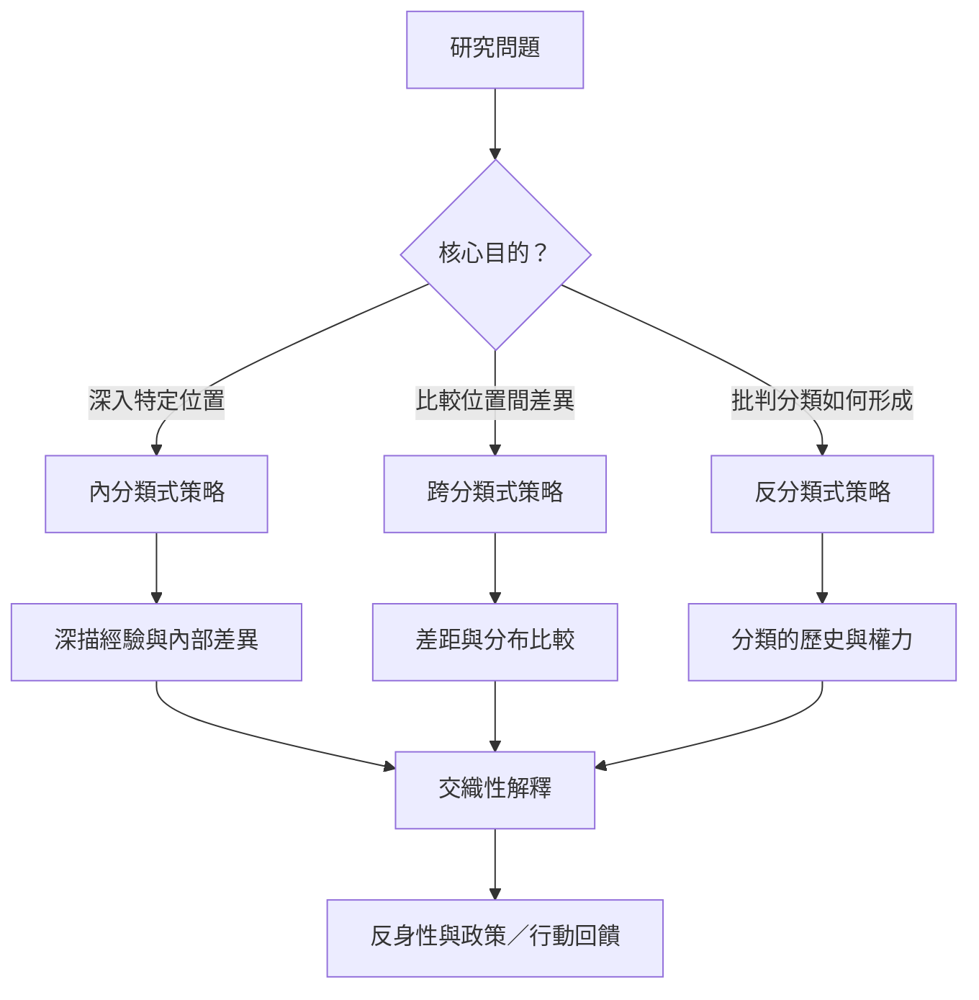

研究者必須根據問題選擇分析路徑。內分類式策略深入理解某個交會位置，跨分類式策略比較不同位置的差異，反分類式策略則反思分類本身的建構與效果。三種策略各有適用範圍與限制，可在同一研究中互補。

本圖連結 [[term/交織性研究方法]]、[[term/內分類式策略]]、[[term/跨分類式策略]]、[[term/反分類式策略]]、[[term/交互作用]]、[[term/反身性]]。

## 思與行
* 先提出權力機制問題，再選方法；不要反過來因為手上有某種資料就硬套交織性。
* 在報告中揭露資料缺口、分類決策、樣本限制與可能的再現風險。

## 參考
* [[data/McCall以三種分類策略處理交織性研究的複雜性]]、[[data/量化交織性研究常用交互分類但仍需避免把群體差異本質化]]。

參見 [[Intersectionality]]。
