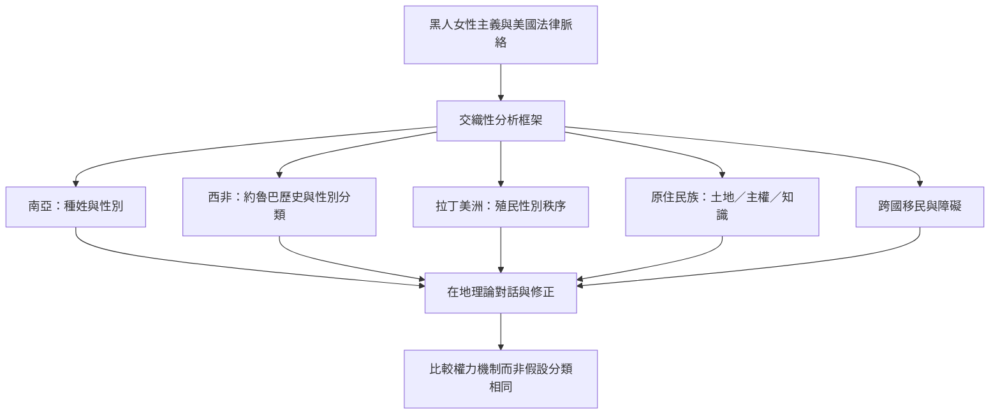

交織性在不同地區的應用，需要和地方歷史、法律、文化與政治運動對話。Dalit 女性主義、約魯巴知識、拉丁美洲去殖民女性主義、原住民族知識與移民研究，不是把同一套分類換成當地名字，而是在提醒理論本身也有地理與知識位置。

本圖連結 [[term/去殖民女性主義]]、[[term/種姓]]、[[term/原住性]]、[[term/性別殖民性]]、[[term/知識不正義]]、[[note/全球應用必須從在地歷史出發而不是複製美國身分分類]]。

## 思與行
* 每個跨國比較都應把地方概念與研究者翻譯方式一起記錄。
* 讓地方知識生產者參與研究解釋，並明確指出比較的不可通約處。

## 參考
* [[data/Dalit女性生命敘事揭示種姓與性別如何共同組織日常生活]]、[[data/Oyewumi以約魯巴歷史挑戰西方性別分類的普遍化]]、[[data/Lugones指出殖民現代性共同塑造種族性別與異性戀規範]]、[[data/原住民族女性的知識遭遇不正義必須以原住性為分析中心]]。

參見 [[Intersectionality]]。
