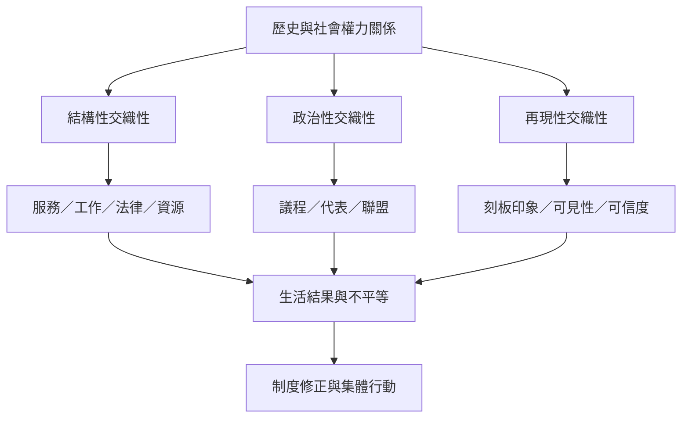

交織性不平等不是單一層次的結果。制度與資源安排、政治議程與代表方式、文化形象與社會想像會共同塑造誰能取得保障、誰能發聲以及誰被認為值得保護。

本圖連結 [[term/結構性交織性]]、[[term/政治性交織性]]、[[term/再現性交織性]]、[[term/交織性歧視]]、[[term/實質平等]]、[[note/壓迫在結構制度人際與文化再現層次共同運作]]。

## 思與行
* 選定一個制度案例，分別記錄結構、政治與再現層次的證據，再追蹤它們如何互相強化。
* 改善方案要同時考慮資源、決策權與公共敘事。

## 參考
* [[data/Crenshaw以家庭暴力與性暴力案例說明交織性如何作用於制度支持]]、[[data/國際人權政策仍常以單一歧視理由處理結構性不平等]]。

參見 [[Intersectionality]]。
