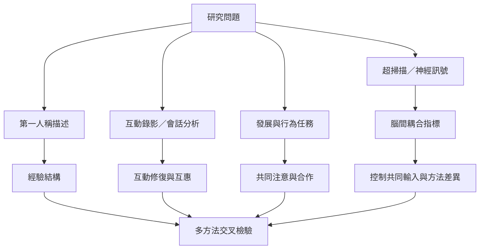

本圖整理互為主體性研究常見方法與證據層次：現象學描述、對話分析、發展研究、行為任務與超掃描。各方法回答的問題不同，任何單一方法都不應被視為完整測量互為主體性的工具。

## 關係圖

## 參考
* 相關筆記：[[腦間同步不能單獨證明共享意識]]、[[身體同步可能支持互動但不能證明彼此理解]]、[[測量互動時必須區分共同輸入與真正互惠]]。
* 概念：[[超掃描]]、[[人際神經同步]]、[[修復]]、[[共同注意]]。
* 延伸：[[為人際神經同步研究建立防止過度詮釋的檢核表]]。
