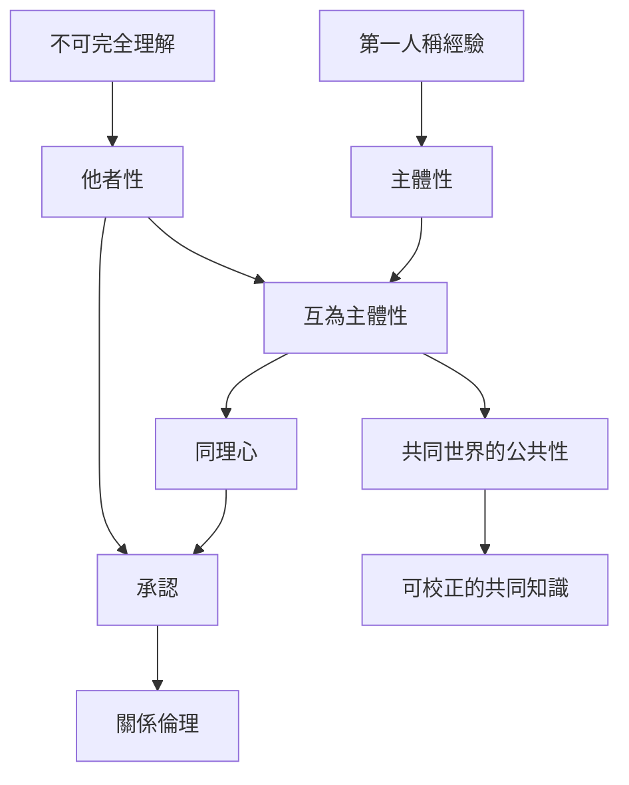

本圖從現象學的他者經驗出發，連接同理、主體性、承認、倫理與跨文化關係論。核心問題不是如何消除自他差異，而是如何在差異持續存在時，建立可回應、可修正且不把他者對象化的共同世界。

## 關係圖

## 參考
* 相關筆記：[[互為主體性不等於心靈融合]]、[[同理不是把自己的感受投射到他人身上]]、[[主體性與關係性不是非此即彼]]、[[客觀世界的公共性依賴多個觀點的可校正性]]。
* 概念：[[互為主體性]]、[[主體性]]、[[他者性]]、[[同理心]]、[[承認]]、[[生活世界]]。
* 延伸地圖：[[生活世界、語言與共同理解如何生成]]、[[關係性自我、文化與集體生活]]。
