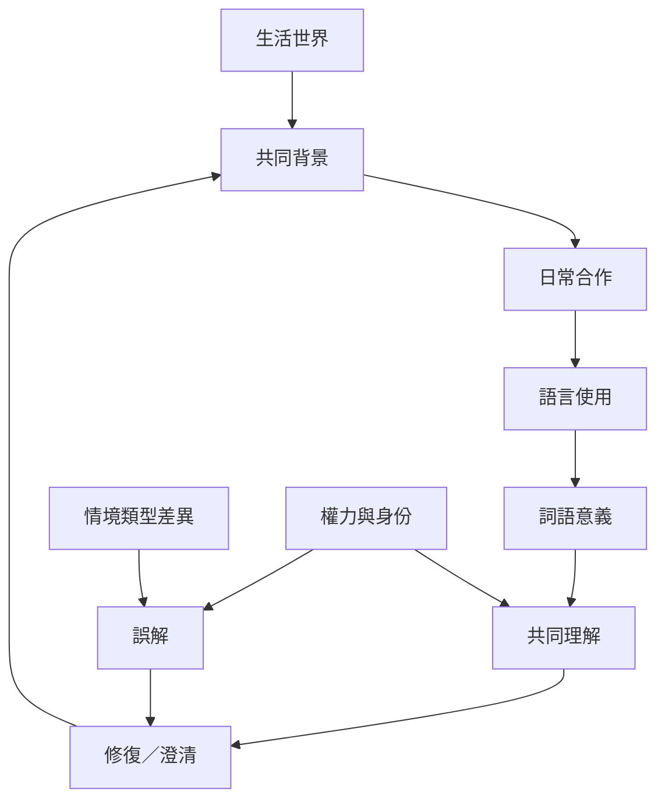

本圖把日常生活的隱性共同背景、語言互動與會話修復連接起來。共同理解不是一次建立後永久有效，而是透過不斷指涉、回應、澄清與修正維持。

## 關係圖

## 參考
* 相關筆記：[[日常合作依賴未明說的共同背景]]、[[誤解常源於情境類型不同而非單純資訊不足]]、[[詞語的意義在共同使用與修正中形成]]、[[共同理解需要持續修復而非一次達成]]。
* 概念：[[生活世界]]、[[共同背景]]、[[對話]]、[[修復]]、[[互為主體性]]。
* 延伸地圖：[[互為主體性的哲學根基與倫理問題]]、[[集體意向、承認與共同生活的政治面向]]。
